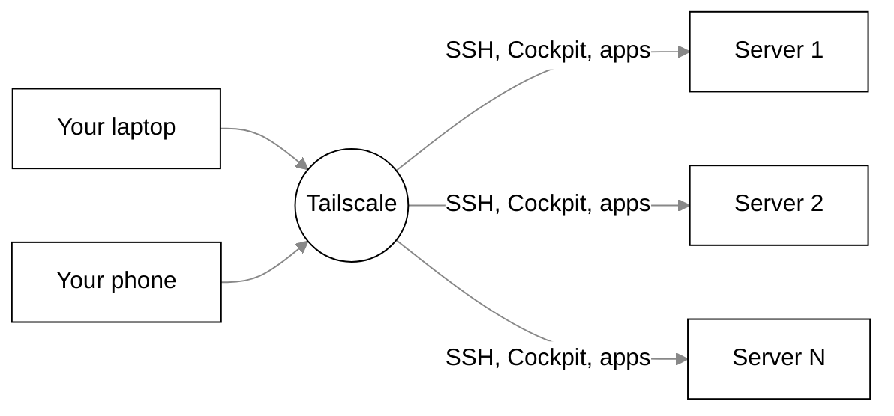
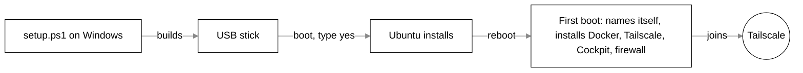

# home_server

Turn any old laptop or PC into a Linux home server from one USB stick. Plug the stick in, boot
from it, type `yes` once, and the machine installs Ubuntu Server and sets itself up: Docker,
Tailscale, the Cockpit web dashboard, a firewall, automatic security updates, and on laptops a
battery charge limit and lid-closed running. Every server then shows up by name on your
Tailscale network, so you can reach all of them from your laptop or phone, at home or away.
The same stick sets up as many machines as you like.

## Which machines work

- **Works:** any 64-bit Intel or AMD (x86-64) laptop, desktop or mini PC that boots with UEFI,
  roughly anything from 2012 on. Secure Boot can stay on.
- **Minimum:** 4 GB of RAM and a 32 GB internal disk. More helps if you run many apps.
- **Does not work:** ARM machines (Raspberry Pi, Apple Silicon Macs, most Chromebooks). They
  need a different Ubuntu image.
- **Laptop extras:** the battery limit needs firmware support. ThinkPads have it, and so do many
  recent Dell, ASUS and Lenovo models. Where it is missing, the machine still works, it just
  charges to 100%. On a desktop the battery and lid settings do nothing and do no harm.

## What you get

| Piece | What it does |
|---|---|
| Ubuntu Server 26.04.1 LTS | The operating system, with security updates until 2031. No desktop. |
| Tailscale | A private network between your devices. Reach the server from anywhere, nothing opened on your router. Logins use Tailscale SSH, so there are no SSH keys to manage. |
| Cockpit | Web dashboard at `https://<hostname>:9090`: CPU, memory, disk, logs, services, a terminal. |
| Docker + Compose | Runs your apps in containers. |
| Firewall (ufw) | Everything allowed over Tailscale. Cockpit also from the home network. Nothing else in. SSH works only over Tailscale; if Tailscale is down, use the server's own keyboard and screen. |
| Automatic security updates | `unattended-upgrades`, daily. |
| Battery limit (TLP) | Laptops: charges only between 60% and 80% so the battery does not swell from being plugged in all the time. |
| Lid closed | Laptops: keeps running with the lid shut. The screen turns off after 60 seconds. |

How you reach your servers:



How a machine becomes a server:



## What you need

- The machine to turn into a server (see [Which machines work](#which-machines-work)).
  **Its whole internal disk is erased.**
- A USB stick of 16 GB or more. **It is erased too.**
- A network connection: Ethernet, Wi-Fi, or both (see [Wi-Fi or Ethernet](#wi-fi-or-ethernet)).
- A Windows PC to build the USB stick, with [Git for Windows](https://git-scm.com/) (for `openssl`).
- A free [Tailscale](https://tailscale.com) account, with the Tailscale app on the devices you
  want to reach the server from.

## Build the USB stick (on Windows)

The quick way: plug in the USB stick, open PowerShell in this folder and run

```powershell
powershell -ExecutionPolicy Bypass -File .\setup.ps1
```

It asks for a user name, time zone, battery limits, an optional Tailscale key,
your password and an optional Wi-Fi network (with its password). Each question has a default, so you can press Enter; the time zone default is
detected from your PC. It hashes the password with OpenSSL (the password itself is never saved) and
writes `server.local.env`. Then it lists your USB disks, and opens an Administrator window that
runs `build-usb.ps1` on the one you pick. Windows asks you to allow that window.

The same steps by hand:

1. **Create your config.** Copy `server.local.env.example` to `server.local.env` and fill it in.
   This file is gitignored and stays on your PC.
   - `PASSWORD_HASH`: in Git Bash, run `openssl passwd -6`, type your password twice, and paste
     the output (starts with `$6$`). This password is for the console and Cockpit.
   - `WIFI_SSID` and `WIFI_PSK` (optional, uncomment to use): the network name and its WPA2 key,
     which `setup.ps1` makes for you. By hand, the key is 64 hex characters from PBKDF2-HMAC-SHA1
     of the password with the network name as salt (the example file has the details).
   - `TAILSCALE_AUTHKEY` (optional): create a **reusable** key at
     [Tailscale admin → Settings → Keys](https://login.tailscale.com/admin/settings/keys).
     With it, each server joins your network on its own. Without it, you run one command after
     the first boot.
2. **Find the USB stick's disk number:** in PowerShell, run `Get-Disk` and look for the USB
   stick by name and size.
3. **Build it:** in an **Administrator** PowerShell, in this folder:
   ```powershell
   powershell -ExecutionPolicy Bypass -File .\build-usb.ps1 -DiskNumber <number>
   ```
   (`-ExecutionPolicy Bypass` is needed because Windows blocks scripts by default. It applies to
   this one run only.) It checks your config, downloads the Ubuntu ISO (about 3 GB) and checks its
   checksum. It refuses any disk that is not USB, is a system disk, or is under 9 GB, and asks you
   to type `ERASE` before touching the stick. The stick ends up with an 8 GB installer partition
   and the rest as a normal `DATA` partition. To use a newer Ubuntu point release, add
   `-UbuntuVersion 26.04.2`.

## Install on the machine

1. Back up anything on the machine you want to keep.
2. Plug in the USB stick, the Ethernet cable if you use one, and connect the charger.
3. Power on and press the boot menu key (table below), then pick the USB stick.
4. **Try or Install Ubuntu Server** is picked by itself after a few seconds. When it asks
   `Continue with autoinstall? (yes|no)`, type `yes`.
5. Wait. The install takes about 10–20 minutes, then the machine reboots. **Remove the USB stick
   when it restarts.**
6. On the first boot it sets itself up (updates, Docker, Tailscale, firewall), which takes another
   5–15 minutes, then reboots once more. Progress is in `/var/log/server-firstboot.log`.

| Brand | Boot menu | BIOS setup |
|---|---|---|
| Lenovo ThinkPad | F12 (or Enter at the logo, then F12) | F1 |
| Lenovo IdeaPad | F12 | F2 |
| Dell | F12 | F2 |
| HP | Esc, then F9 | Esc, then F10 |
| ASUS | Esc or F8 | F2 or Del |
| Acer | F12 (turn on "F12 Boot Menu" in the BIOS first) | F2 |
| MSI | F11 | Del |
| Intel Mac | hold Option | none |

Start tapping the key as soon as you press the power button. If F keys don't respond, hold
**Fn** too.

Optional BIOS setting: if there is a **Power On with AC Attach** (or "AC Power Recovery")
option, turn it on so the server starts by itself after a power cut.

## After the install

- **If you left `TAILSCALE_AUTHKEY` empty:** log in at the machine and run `sudo tailscale up --ssh`,
  then open the link it prints.
- In the [Tailscale admin console](https://login.tailscale.com/admin/machines), open the server's
  menu and choose **Disable key expiry**, so it does not drop off your network after 180 days.
- In your router, give the server a **DHCP reservation** so its home IP address never changes.

## Wi-Fi or Ethernet

`setup.ps1` asks for a Wi-Fi network (it suggests the one your PC is on) and its password. Press Enter
to skip Wi-Fi. The server keeps only the network name and a key made from the password, never the
password itself.

- Both Ethernet and Wi-Fi are set up. Whichever is connected works, and the cable is preferred when
  both are.
- The install itself needs no network. First-boot setup waits up to 5 minutes for internet, so
  Wi-Fi has time to connect.
- To switch Wi-Fi off later: `sudo rm /etc/netplan/60-wifi.yaml && sudo netplan apply`.
- WPA3-only networks are not supported. WPA2 and WPA2/WPA3 mixed networks work.
- Wi-Fi gives the server a different IP address from Ethernet. Give each a **DHCP reservation**
  in your router if you need fixed addresses.

## Server names

The stick holds no server name, so one stick sets up any number of machines. On its first boot,
each server names itself from its model and the last 4 characters of its serial number, for
example `thinkpad-x1-carbon-5th-bc12` (or `server-<4 characters>` if the firmware gives no
model). Find it in the [Tailscale admin console](https://login.tailscale.com/admin/machines),
or at the top of `/var/log/server-firstboot.log`. For a shorter name, rename the machine there
(**⋯ → Edit machine name**); the new name then works for SSH and Cockpit too.

## Using it

From any device with Tailscale switched on, with `<server>` being the server's name:

| From | How |
|---|---|
| Computer terminal | `ssh <user>@<server>` |
| Browser (computer or phone) | `https://<server>:9090`. Log in with your user and password. The browser warns about the certificate the first time, which is expected. |
| Phone terminal | [Termius](https://termius.com) or Blink Shell, host `<server>`, your user. |

Run apps with Docker Compose, one folder per app under `~/apps/<app>/`. Moving an app to another
server is copying its folder.

Note: ports published by Docker bypass the ufw firewall. Publish only what you mean to expose,
or bind them to the Tailscale address.

## Adding another server

Plug the same USB stick into the next machine and install. It gets its own name (see
[Server names](#server-names)). With a reusable `TAILSCALE_AUTHKEY` that hasn't expired, it
appears on your network by itself.

## Check the battery limit and other settings

```bash
sudo tlp-stat -b                  # charge thresholds in effect
systemctl status server-firstboot # first-boot setup result
sudo ufw status verbose           # firewall rules
tailscale status                  # devices on your network
```

## Layout

| Path | What it is |
|---|---|
| `autoinstall.template.yaml` | Ubuntu autoinstall config, with placeholders for your values. |
| `server-setup/firstboot.sh` | The one-time setup that runs on the server's first boot. |
| `server-setup/make-hostname.sh` | Works out the server's name from its model and serial number. |
| `server-setup/install-wifi.sh` | Runs during the install: sets up Wi-Fi on the server if the stick has a Wi-Fi file. |
| `server-setup/wifi.yaml.template` | Netplan Wi-Fi config, filled in by `build-usb.ps1` only when Wi-Fi is set up. |
| `server-setup/server-firstboot.service` | Runs `firstboot.sh` once, after the network is up. |
| `server-setup/server.env.template` | Values passed to `firstboot.sh`. Deleted from the server after use. |
| `server.local.env.example` | Copy to `server.local.env` (gitignored) and fill in. |
| `setup.ps1` | Asks your settings, creates `server.local.env`, then runs `build-usb.ps1`. Start here. |
| `build-usb.ps1` | Builds the USB stick on Windows. |
| `lib/render.ps1` | Reads the config, checks it, and fills the templates. |
| `tests/` | Pester tests: `powershell -ExecutionPolicy Bypass -Command "Invoke-Pester -Path .\tests"` |

## Troubleshooting

- **The boot menu doesn't open:** tap the key repeatedly from power-on, try it with **Fn**, and
  if Windows is still installed, hold **Shift** while clicking **Shut down** (Windows Fast
  Startup can skip the menu). Or, in the BIOS setup, move the USB drive to the top of the boot
  order.
- **The USB stick does not show up in the boot menu:** in the BIOS setup, check that USB boot is
  enabled and boot mode is UEFI.
- **"Secure Boot violation":** turn Secure Boot off in the BIOS setup. Ubuntu normally boots with
  it on.
- **The installer asks questions instead of installing:** it did not find `autoinstall.yaml`.
  Rebuild the stick with `build-usb.ps1`.
- **First-boot log says "No internet: plug in Ethernet or check the Wi-Fi settings":** the server
  could not resolve the Ubuntu archive in 5 minutes. Plug in Ethernet, or check the Wi-Fi name and
  password (rebuild the stick if they were wrong). It tries again on the next boot.
- **First-boot setup failed:** read `/var/log/server-firstboot.log`, fix the cause, then run
  `sudo /opt/server-setup/firstboot.sh` again. It also runs again on every boot until it finishes.
  Once it has finished, it deletes its settings file, and running it again does nothing.
- **Can't reach the server at all:** Tailscale is the only way in over SSH. Log in at the machine
  itself and check `tailscale status` and `/var/log/server-firstboot.log`.
