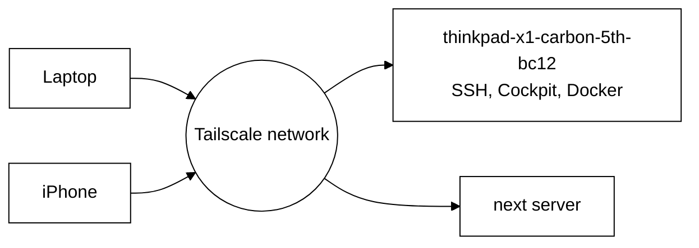

# home_server

Turn an old laptop into a Linux home server from one USB stick. Plug the stick in, boot from it,
type `yes` once, and the laptop installs Ubuntu Server and sets itself up: Docker, Tailscale,
the Cockpit web dashboard, a firewall, automatic security updates, a battery charge limit and
lid-closed running. Every server then shows up by name on your Tailscale network, so you can
reach all of them from your laptop or phone, at home or away.

Built for a ThinkPad X1 Carbon (5th gen), but works on most x86-64 laptops.

## What you get

| Piece | What it does |
|---|---|
| Ubuntu Server 26.04.1 LTS | The operating system, with security updates until 2031. No desktop. |
| Tailscale | A private network between your devices. Reach the server from anywhere, nothing opened on your router. Logins use Tailscale SSH, so there are no SSH keys to manage. |
| Cockpit | Web dashboard at `https://<hostname>:9090`: CPU, memory, disk, logs, services, a terminal. |
| Docker + Compose | Runs your apps in containers. |
| Firewall (ufw) | Everything allowed over Tailscale. Cockpit also from the home network. Nothing else in. SSH works only over Tailscale; if Tailscale is down, use the laptop's own keyboard and screen. |
| Automatic security updates | `unattended-upgrades`, daily. |
| Battery limit (TLP) | Charges only between 60% and 80% so the battery does not swell from being plugged in all the time. |
| Lid closed | The laptop keeps running with the lid shut. The screen turns off after 60 seconds. |



## What you need

- The laptop to turn into a server. **Its whole internal disk is erased.**
- A USB stick of 16 GB or more. **It is erased too.**
- A wired network connection for the install. Laptops without an Ethernet port need a
  USB-Ethernet adapter (Realtek RTL8153 or ASIX chips work with no setup).
- A Windows PC to build the USB stick, with [Git for Windows](https://git-scm.com/) (for `openssl`).
- A free [Tailscale](https://tailscale.com) account, with the Tailscale app on the devices you
  want to reach the server from.

## Build the USB stick (on Windows)

The quick way: plug in the USB stick, open PowerShell in this folder and run

```powershell
powershell -ExecutionPolicy Bypass -File .\setup.ps1
```

It asks for a user name, time zone, battery limits, an optional Tailscale key and
your password. Each question has a default, so you can press Enter; the time zone default is
detected from your PC. It hashes the password with OpenSSL (the password itself is never saved) and
writes `server.local.env`. Then it lists your USB disks, and opens an Administrator window that
runs `build-usb.ps1` on the one you pick. Windows asks you to allow that window.

The same steps by hand:

1. **Create your config.** Copy `server.local.env.example` to `server.local.env` and fill it in.
   This file is gitignored and stays on your PC.
   - `PASSWORD_HASH`: in Git Bash, run `openssl passwd -6`, type your password twice, and paste
     the output (starts with `$6$`). This password is for the console and Cockpit.
   - `TAILSCALE_AUTHKEY` (optional): create a **reusable** key at
     [Tailscale admin → Settings → Keys](https://login.tailscale.com/admin/settings/keys).
     With it, each server joins your network on its own. Without it, you run one command after
     the first boot.
2. **Find the USB stick's disk number:** in PowerShell, run `Get-Disk` and look for the USB
   stick by name and size.
3. **Build it:** in an **Administrator** PowerShell, in this folder:
   ```powershell
   powershell -ExecutionPolicy Bypass -File .\build-usb.ps1 -DiskNumber <number>
   ```
   (`-ExecutionPolicy Bypass` is needed because Windows blocks scripts by default. It applies to
   this one run only.) It checks your config, downloads the Ubuntu ISO (about 3 GB) and checks its
   checksum. It refuses any disk that is not USB, is a system disk, or is under 9 GB, and asks you
   to type `ERASE` before touching the stick. The stick ends up with an 8 GB installer partition
   and the rest as a normal `DATA` partition. To use a newer Ubuntu point release, add
   `-UbuntuVersion 26.04.2`.

## Install on the laptop

1. Back up anything on the laptop you want to keep.
2. Plug in the USB stick and the Ethernet cable, and connect the charger.
3. Power on and press **F12** (ThinkPad; other brands use F12, F10, F9 or Esc). Pick the USB stick.
4. Pick **Try or Install Ubuntu Server**. When it asks `Continue with autoinstall? (yes|no)`,
   type `yes`.
5. Wait. The install takes about 10–20 minutes, then the laptop reboots. **Remove the USB stick when
   it restarts.**
6. On the first boot it sets itself up (updates, Docker, Tailscale, firewall), which takes another
   5–15 minutes, then reboots once more. Progress is in `/var/log/server-firstboot.log`.

Optional BIOS setting (F1 at power-on on a ThinkPad): if there is a **Power On with AC Attach**
option, turn it on so the server starts by itself after a power cut.

## After the install

- **If you left `TAILSCALE_AUTHKEY` empty:** log in at the laptop and run `sudo tailscale up --ssh`,
  then open the link it prints.
- In the [Tailscale admin console](https://login.tailscale.com/admin/machines), open the server's
  menu and choose **Disable key expiry**, so it does not drop off your network after 180 days.
- In your router, give the server a **DHCP reservation** so its home IP address never changes.

## Server names

The stick holds no server name, so one stick sets up any number of laptops. On its first boot,
each server names itself from its model and the last 4 characters of its serial number, for
example `thinkpad-x1-carbon-5th-bc12` (or `server-<4 characters>` if the firmware gives no
model). Find it in the [Tailscale admin console](https://login.tailscale.com/admin/machines),
or at the top of `/var/log/server-firstboot.log`. For a shorter name, rename the machine there
(**⋯ → Edit machine name**); the new name then works for SSH and Cockpit too.

## Using it

From any device with Tailscale switched on, with `<server>` being the server's name:

| From | How |
|---|---|
| Laptop terminal | `ssh <user>@<server>` |
| Browser (laptop or iPhone) | `https://<server>:9090`. Log in with your user and password. The browser warns about the certificate the first time, which is expected. |
| iPhone terminal | [Termius](https://termius.com) or Blink Shell, host `<server>`, your user. |

Run apps with Docker Compose, one folder per app under `~/apps/<app>/`. Moving an app to another
server is copying its folder.

Note: ports published by Docker bypass the ufw firewall. Publish only what you mean to expose,
or bind them to the Tailscale address.

## Adding another server

Plug the same USB stick into the next laptop and install. It gets its own name (see
[Server names](#server-names)). With a reusable `TAILSCALE_AUTHKEY` that hasn't expired, it
appears on your network by itself.

## Check the battery limit and other settings

```bash
sudo tlp-stat -b                  # charge thresholds in effect
systemctl status server-firstboot # first-boot setup result
sudo ufw status verbose           # firewall rules
tailscale status                  # devices on your network
```

## Layout

| Path | What it is |
|---|---|
| `autoinstall.template.yaml` | Ubuntu autoinstall config, with placeholders for your values. |
| `server-setup/firstboot.sh` | The one-time setup that runs on the server's first boot. |
| `server-setup/make-hostname.sh` | Works out the server's name from its model and serial number. |
| `server-setup/server-firstboot.service` | Runs `firstboot.sh` once, after the network is up. |
| `server-setup/server.env.template` | Values passed to `firstboot.sh`. Deleted from the server after use. |
| `server.local.env.example` | Copy to `server.local.env` (gitignored) and fill in. |
| `setup.ps1` | Asks your settings, creates `server.local.env`, then runs `build-usb.ps1`. Start here. |
| `build-usb.ps1` | Builds the USB stick on Windows. |
| `lib/render.ps1` | Reads the config, checks it, and fills the templates. |
| `tests/` | Pester tests: `powershell -ExecutionPolicy Bypass -Command "Invoke-Pester -Path .\tests"` |

## Troubleshooting

- **The USB stick does not show up in the F12 menu:** in the BIOS (F1), check that USB boot is
  enabled and boot mode is UEFI.
- **The installer asks questions instead of installing:** it did not find `autoinstall.yaml`.
  Rebuild the stick with `build-usb.ps1`.
- **First-boot setup failed:** read `/var/log/server-firstboot.log`, fix the cause, then run
  `sudo /opt/server-setup/firstboot.sh` again. It also runs again on every boot until it finishes.
  Once it has finished, it deletes its settings file, and running it again does nothing.
- **Can't reach the server at all:** Tailscale is the only way in over SSH. Log in at the laptop
  itself and check `tailscale status` and `/var/log/server-firstboot.log`.
